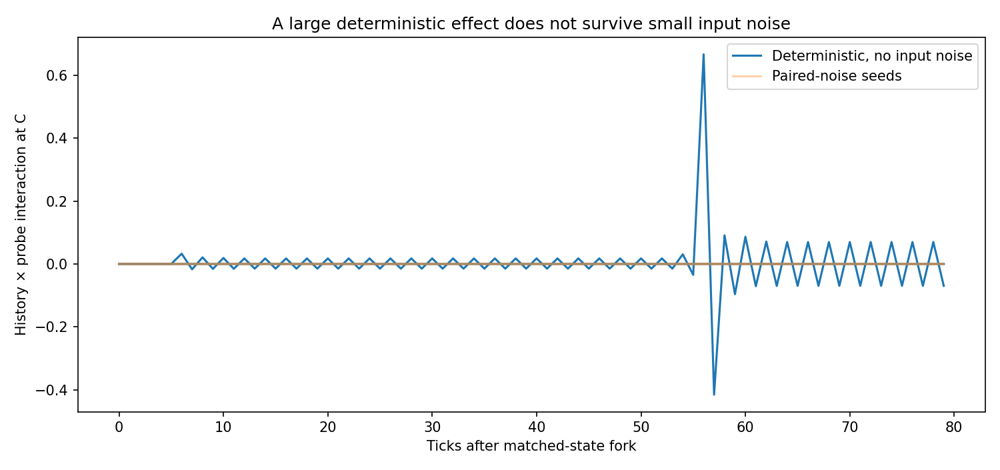

# Three-loop state-transfer assay from the original Perception Lab ECG graph



**Experiment 5 · 2026-10-29**

Independent, headless reconstruction of `anttiluode/GeometricNeuronOriginReview`'s `ecg.json`. It runs **three separate** `HomeostaticCoupler → Checkerboard → ImageToVector → four samples → HomeostaticCoupler` loops, with independent 200-step input histories and 50-step variance windows.

**New and intentionally engineered:** one-tick-delayed scalar connections A→B→C, each carrying `0.2 * (previous_output - 0.6)` into the downstream homeostat input. The original `ecg.json` contains **one** loop and no such connections. The original source files are not modified, and this is not biological membrane or physical wave propagation.

## Run

```bash
python -m pip install numpy opencv-python matplotlib pytest
python reproduce.py
python -m pytest -q test_three_loop.py
python three_loop.py --out results/other.json --hold 30 --dim 1024
```

## Protocol

1. Warm three mutually coupled loops for **140 ticks**. In a paired intervention, inject A with amplitude **0.5 for 12 ticks**, or sham amplitude zero. Run **8 more ticks** without injected current. Both branches use the same initial state and (when enabled) the same noise.
2. **Natural propagation:** disconnect A→B. Compare B and C between the stimulated and sham worlds. This measurement includes all differences already present in B and C.
3. **Matched-visible-state memory graft:** clone the entire sham world twice, including A, C, outputs, observation geometry, integral state, controller regimes and clock. Replace **only B's older input-history entries** in one clone with the A-stimulated B history. Its latest input-history entry is kept equal to the sham value, so even the currently measured input is matched. Disable A→B, retaining B→C. Apply the same later 3-tick input at B (amplitude **0.15**) and record the subsequent 80 ticks.
4. **Causal controls:** a no-probe twin for each history measures the incremental response (difference-in-differences). Run a separate pair with B→C disconnected. Also test a zero A write, longer holds, and a vector-dimension change with the same input schedule.
5. **Robustness:** paired Gaussian input noise SD **0.003**, seeds 1–8. The noise is identical across the matched/sham branches of each trial. This is *shared-noise causal inference*, not independent-noise decoding fidelity.

## Reproduced result

| Condition | Measured maximum absolute effect on C |
|---|---:|
| Natural A pulse → B → C, A disconnected at checkpoint | **0.000328** |
| B history transplanted, all immediately visible outputs/states matched | **0.666833** history × later-probe interaction (deterministic) |
| Same transplanted histories, **no later probe** | **0.000135** |
| B→C link cut | **0.000000** |
| No initial pulse at A | **0.000000** |
| 60-tick hold before matched-history fork | **< 0.000001** |
| Vector dimension 1024 instead of 256 | **0.000000** |

In the selected deterministic example, A changes B's controller history (`L2 = 0.070575`). The grafted histories have different 50-tick variances (`0.139218` vs `0.139642`), although B's *present* controller output and the entire state of C are matched when the second experiment begins. The resulting nonlinear difference can be very large. The no-probe difference stays tiny. Cutting the B→C connection makes C identical: the intervention is causally mediated by B.

**The robustness result is the main negative.** At noise SD=0.003, the exact default configuration has **0/8** paired preparations with an interaction exceeding **0.05**. The deterministic peak is therefore *not* evidence of a reliable state-relay or sustainable computation. It is a sensitive discrete feedback switch. At a longer hold the effective memory is lost even though older entries in the 200-element history may still differ: the controller actively consults only the most recent 50 entries.

The 1024-D experiment is an important observer control: the first four spatial samples now cover only the leftmost 32 pixels, often all black. Changing the observation geometry can destroy the particular dynamic even though the generated checkerboard rule is unchanged.

## Reproduction boundaries

- `step()` uses one synchronous update per tick. PyQt's original graph scheduler isn't checked here, so exact timing in the historical GUI is **not established**.
- Checkerboard generation, `INTER_AREA` downsampling, first-four-sample selection, max-abs normalization, `setpoint = 0.5 + 1.0*0.1`, variance rule and `tanh` equations follow the original source. The original edge-of-chaos `integral_state` is updated but **does not influence the output**. `np.var` uses population variance, as in the source.
- The original checkerboard doesn't clip its square size; this reconstruction also allows **negative** square sizes and raises if it becomes exactly zero (the original would divide by zero). No silent clipping repair.
- The new scalar A→B→C link is a **declared modeling choice**, not naturally derived coupling. The matched-history transplant is an explicit counterfactual intervention, not a naturally occurring biological manipulation.
- No independently noisy input decoding, stable multi-hop relay, or emergent plasticity has been demonstrated.

## What this decides

This supplies one constrained *yes*: in a deliberately coupled digital feedback system, B's previously received inputs can affect C's response to a later identical probe, when all immediately visible states have been matched. It supplies a stronger *no* for the current parameters: this effect is fragile and not robust to modest input noise.

**Next gate:** replace the fragile variance switch with an independently measured, locally bounded slow state; require held-out cross-preparation reliability and distinguish useful sensitivity from spontaneous history-driven divergence. Only after that compare it with phase-memory chains.


## Experiment 6: local slow-state relay (separate engineered model)

The original ECG-variance assay above remains unchanged and its negative noise result still stands. The next experiment adds a **new bounded leaky state law** and an explicit geometry-sensitive receiver gate to ask whether A→B→C transfer can become robust after those mechanisms are supplied. This is a constructive engineering experiment, not emergent neuronal physics.

[Read the protocol, held-out tests, controls, results and limitations](experiments/RESULTS.md). Source: [experiments/slow_state_relay.py](experiments/slow_state_relay.py); tests: [experiments/test_slow_state_relay.py](experiments/test_slow_state_relay.py).

~~~bash
python -m experiments.slow_state_relay
python -m pytest -q test_three_loop.py experiments/test_slow_state_relay.py
~~~


## Experiment 7: always-connected adaptive chain

[Read Experiment 7 results, controls and limits](experiments/CONTINUOUS_RESULTS.md).
[Model](experiments/continuous_adaptive.py) · [Tests](experiments/test_continuous_adaptive.py) · [160-seed-per-sign noise-sweep receipt](experiments/results/continuous_adaptive_summary.csv).

Unlike Experiment 6, both A→B and B→C remain active throughout the normal warm-up, write and hold periods. An engineered local homeostat adjusts receiver gain using only the receiver's own memory activity. A second, explicitly **diagnostic** readout isolates C for one tick after propagation so its persistent local state can be distinguished from B's ongoing transmission.

At noise SD 0.003, held-out isolated C-output decoding was 100% for **both** adaptive and fixed gain. Knocking out B memory, removing B→C, or erasing C memory before local readout returned decoding to roughly chance. At noise SD 0.03: adaptive 90.6%, fixed 92.5%. At SD 0.1: adaptive 70%, fixed 65%; however decoding the *change caused by the probe* was only 55.6%. Thus the successful state relay **does not establish that adaptation was required or consistently beneficial**.

Reproduce from repository root:

~~~bash
python -m experiments.continuous_adaptive --seeds 160
python -m pytest -q test_three_loop.py experiments/test_slow_state_relay.py experiments/test_continuous_adaptive.py
~~~
